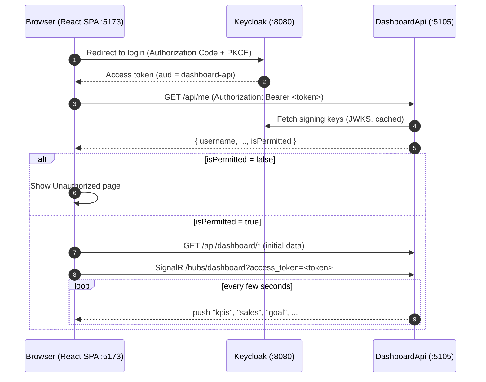

# React Keycloak Dashboard

A single-page sales dashboard built with **React**. Users sign in through **Keycloak**, and the data comes from a **.NET 10 Minimal API**, which pushes live updates over **SignalR**.

It's a proof of concept for this end-to-end pattern:

1. **Sign-in:** a browser SPA signs users in with Keycloak (OpenID Connect, Authorization Code + PKCE).
2. **Authentication:** the API validates Keycloak access tokens.
3. **Access control:** the API applies its own rule on top of Keycloak: only users listed in `appsettings.json` may use the dashboard.
4. **Live updates:** the same token protects a real-time SignalR connection.

---

## Contents

- [Features](#features)
- [Architecture](#architecture)
- [Tech stack](#tech-stack)
- [Project structure](#project-structure)
- [Getting started](#getting-started)
- [Configuration](#configuration)
- [How authentication and authorization work](#how-authentication-and-authorization-work)
- [How live updates work](#how-live-updates-work)
- [API reference](#api-reference)
- [Dashboard layout](#dashboard-layout)
- [Extending the project](#extending-the-project)
- [Troubleshooting](#troubleshooting)
- [Security notes and going to production](#security-notes-and-going-to-production)

---

## Features

- **Keycloak login.** Opening the dashboard redirects to Keycloak's login page, and `keycloak-js` refreshes tokens automatically in the background.
- **Permitted-users check.** A valid Keycloak login is not enough on its own. The user must also be listed in `PermittedUsers` in the API's `appsettings.json`. Signed-in users who aren't listed see an **Unauthorized** page with buttons to sign in with another account or sign out.
- **Protected .NET 10 Minimal API.** Every endpoint and the SignalR hub require a valid token **and** a permitted user, and new endpoints are protected by default.
- **Live data over SignalR.** The page loads its data through normal API calls, then the server pushes changes as they happen. A **Live** badge in the header shows the connection status.
- **Charts and widgets:**
  - three status cards (Planned / Completed / Cancelled)
  - a horizontal bar chart in **auto-rotating tabs** (by month, region, product, channel and sales rep)
  - a half-donut goal gauge
  - a speedometer with red, amber and green zones
  - a traffic line chart
  - an attendance count grid
- **Responsive and theme-aware.** Works on phones and adapts to light or dark mode.

---

## Architecture



| Component | Port | Role |
|---|---|---|
| Keycloak | `8080` | Identity provider. Realm `mvc-sample`, public client `react-dashboard`. |
| DashboardApi | `5105` | Validates tokens, enforces `PermittedUsers`, serves data and pushes live updates. |
| Dashboard (Vite) | `5173` | React SPA: login, access gate and charts. |

---

## Tech stack

| Area | Choice | Why |
|---|---|---|
| Frontend framework | **Vite + React 19 + TypeScript** | The dashboard is one client-side page behind a login. It doesn't need server rendering or SEO, so Next.js would only add complexity. |
| Auth (browser) | **keycloak-js** | Keycloak's official SPA adapter. It handles the PKCE login, token refresh and logout. |
| Charts | **Recharts** | Declarative React charts. The half donut is a `PieChart` with `startAngle={180} endAngle={0}`. The speedometer is a hand-written SVG. |
| Live updates (browser) | **@microsoft/signalr** | Official SignalR client, with automatic reconnect. |
| Backend | **.NET 10 Minimal API** | Small and explicit, with no controllers. |
| Auth (server) | **Microsoft.AspNetCore.Authentication.JwtBearer** | Standard JWT validation against Keycloak's signing keys. |
| Styling | Plain CSS with design tokens | No UI framework. Light and dark themes come from CSS variables. |

---

## Project structure

```
react-keyckloak/
├── keycloak/
│   └── mvc-sample-realm.json        Realm export: clients, audience mapper, test users
│
├── backend/DashboardApi/            .NET 10 Minimal API
│   ├── Program.cs                   Auth, policies, CORS, endpoints, SignalR hub mapping
│   ├── appsettings.json             Keycloak, CORS and PermittedUsers settings
│   ├── DashboardApi.http            Ready-made requests for manual testing
│   ├── Authorization/
│   │   ├── AccessOptions.cs         Parses the comma-separated PermittedUsers list
│   │   └── PermittedUserRequirement.cs  Policy names, requirement and handler
│   ├── Data/
│   │   ├── DashboardData.cs         Record types + initial sample data
│   │   └── DashboardStore.cs        Current data, shared by REST and live updates
│   ├── Hubs/
│   │   └── DashboardHub.cs          SignalR hub + event names
│   └── Services/
│       └── LiveDataSimulator.cs     Background service that changes data and pushes it
│
└── dashboard/                       Vite + React + TypeScript SPA
    ├── .env                         Keycloak and API URLs
    └── src/
        ├── main.tsx                 Wires the providers together (see below)
        ├── App.tsx                  Dashboard layout
        ├── index.css                Design tokens, layout and component styles
        ├── auth/
        │   ├── keycloak.ts          Keycloak instance built from .env
        │   ├── AuthProvider.tsx     Login on load, token refresh, logout, switch account
        │   ├── useAuth.ts           Auth context + hook
        │   ├── AccessGate.tsx       Calls /api/me; shows dashboard or Unauthorized
        │   └── Unauthorized.tsx     403 page
        ├── api/
        │   ├── types.ts             TypeScript shapes of the API responses
        │   ├── useApi.ts            GET with Bearer token
        │   ├── hub.ts               SignalR connection factory
        │   ├── LiveProvider.tsx     Owns the connection, status and reconnects
        │   ├── live.ts              Live context + hook
        │   └── useLiveApi.ts        REST first load, then SignalR updates
        └── components/
            ├── Header.tsx           Title, live status badge, user, logout
            ├── KpiCards.tsx         Planned / Completed / Cancelled cards
            ├── AutoTabs.tsx         Tabs that rotate on a timer (pause on hover)
            ├── SalesBarChart.tsx    Horizontal bar chart
            ├── GoalGauge.tsx        Half-donut gauge
            ├── Speedometer.tsx      SVG speedometer with needle and zones
            ├── TrendLineChart.tsx   Line chart with two axes
            ├── AttendanceCards.tsx  2×2 count grid
            ├── ChartCard.tsx        Card wrapper
            └── Loadable.tsx         Loading / error placeholder
```

`main.tsx` nests the providers in this order:

```
AuthProvider  →  AccessGate  →  LiveProvider  →  App
 (Keycloak)     (/api/me check)   (SignalR)      (dashboard)
```

Each layer renders its children only after its own step has succeeded. For example, a user who isn't permitted never opens a SignalR connection.

---

## Getting started

### Prerequisites

- **Node.js** 20+ (developed on 22) and npm
- **.NET SDK 10**
- **Docker**, to run Keycloak

### 1. Start Keycloak

Run Keycloak 26 and import the realm in this repository:

```bash
docker run --name keycloak -p 8080:8080 \
  -e KC_BOOTSTRAP_ADMIN_USERNAME=admin \
  -e KC_BOOTSTRAP_ADMIN_PASSWORD=admin \
  -v "$(pwd)/keycloak/mvc-sample-realm.json:/opt/keycloak/data/import/mvc-sample-realm.json" \
  quay.io/keycloak/keycloak:26.0 start-dev --import-realm
```

The realm file creates:

- **Realm** `mvc-sample`
- **Client** `react-dashboard`. It's public (the SPA keeps no client secret), uses the standard flow with PKCE S256, and allows redirects to `http://localhost:5173/*`. Its **audience mapper** adds `dashboard-api` to the token's `aud` claim.
- **Users:**

| Username | Password | In `PermittedUsers` by default? |
|---|---|---|
| `demo` | `Demo123!` | ✅ yes, so they see the dashboard |
| `guest` | `Guest123!` | ❌ no, so they see the Unauthorized page |

> **Already running Keycloak?** `--import-realm` only imports a realm that **doesn't exist yet**. If `mvc-sample` already exists, the import is skipped. Then you need to add the `react-dashboard` client and its audience mapper by hand (see [Troubleshooting](#troubleshooting)).

### 2. Start the API

```bash
cd backend/DashboardApi
dotnet run --launch-profile http
```

The API listens on **http://localhost:5105**. To check it's running, `curl http://localhost:5105/api/me` should return `401`, because no token was sent.

### 3. Start the dashboard

```bash
cd dashboard
npm install
npm run dev
```

Open **http://localhost:5173**. You're redirected to Keycloak. Sign in as `demo` / `Demo123!` and the dashboard appears, with the badge reading **Live**.

To see the Unauthorized page, click **Logout** and sign in as `guest` / `Guest123!`.

### Useful commands

| Where | Command | What it does |
|---|---|---|
| `dashboard/` | `npm run dev` | Dev server with hot reload |
| `dashboard/` | `npm run build` | Type-check + production build into `dist/` |
| `dashboard/` | `npm run lint` | Lint with oxlint |
| `backend/DashboardApi/` | `dotnet run --launch-profile http` | Run the API |
| `backend/DashboardApi/` | `dotnet build` | Build the API |

---

## Configuration

### Dashboard: `dashboard/.env`

```env
VITE_KEYCLOAK_URL=http://localhost:8080
VITE_KEYCLOAK_REALM=mvc-sample
VITE_KEYCLOAK_CLIENT_ID=react-dashboard
VITE_API_URL=http://localhost:5105
```

Vite builds these values into the browser bundle, so they must never contain secrets. A public client doesn't need any secrets. Restart `npm run dev` after editing this file.

### API: `backend/DashboardApi/appsettings.json`

```json
{
  "PermittedUsers": "demo",
  "Keycloak": {
    "Authority": "http://localhost:8080/realms/mvc-sample",
    "Audience": "dashboard-api"
  },
  "Cors": {
    "AllowedOrigins": [ "http://localhost:5173" ]
  }
}
```

| Setting | Meaning |
|---|---|
| `PermittedUsers` | Comma-separated list of who may use the dashboard. Each entry is matched, ignoring case, against the token's **username** (`preferred_username`) **or** **user ID** (`sub`, the GUID shown in the Keycloak admin console). Example: `"demo, alice, 8f1c2a4e-0b3d-4c7e-9a51-2f6d8e1b7c90"`. An empty value means **nobody** is permitted. **Changes apply on the next request, with no restart needed.** |
| `Keycloak:Authority` | The realm URL. The API reads Keycloak's discovery document and signing keys from here. It must exactly match the token's `iss` claim. |
| `Keycloak:Audience` | The value the token's `aud` claim must contain. Tokens issued for other clients are rejected. |
| `Cors:AllowedOrigins` | Browser origins allowed to call the API and open the SignalR connection. |

> Settings can be overridden with environment variables, e.g. `PermittedUsers="demo,alice"` or `Keycloak__Authority=https://sso.example.com/realms/prod`.

---

## How authentication and authorization work

### 1. Sign-in (browser ↔ Keycloak)

`src/auth/AuthProvider.tsx` calls `keycloak.init({ onLoad: 'login-required', pkceMethod: 'S256', checkLoginIframe: false })`:

- Visitors without a session are redirected to the Keycloak login page.
- After login, Keycloak redirects back with an authorization code, and `keycloak-js` exchanges it for tokens using **PKCE**. No client secret is involved.
- Shortly before the access token expires (`onTokenExpired`), `keycloak-js` gets a new one. Every API call goes through `getToken()`, which first calls `keycloak.updateToken(30)`, so the token sent is always valid for at least 30 more seconds.
- `checkLoginIframe: false` turns off Keycloak's hidden-iframe session check. That check is blocked by the realm's `frame-ancestors` content security policy.
- `React.StrictMode` is deliberately not used, because it runs effects twice in development and `keycloak-js` can only be initialized once.

### 2. Token validation (API)

`Program.cs` sets up JWT bearer authentication:

- **Signature:** checked against Keycloak's signing keys, which are fetched from the realm's JWKS endpoint and cached.
- **Issuer:** must equal `Keycloak:Authority`.
- **Audience:** must contain `dashboard-api`. Keycloak adds this value through the **audience mapper** on the `react-dashboard` client. Without the mapper, tokens only contain `aud: account` and every request gets `401`.
- **Lifetime:** expired tokens are rejected.
- `MapInboundClaims = false` keeps Keycloak's claim names as they are (`sub`, `preferred_username`, ...).

### 3. Permitted users (API authorization)

Keycloak answers **who** the user is; the API decides whether that user is **allowed in**. This is a standard ASP.NET Core authorization policy:

- `PermittedUserRequirement` + `PermittedUserHandler` (`Authorization/`) check the user's `preferred_username` / `sub` against `AccessOptions.PermittedUsers`. The list is read through `IOptionsMonitor`, which is why edits apply without a restart. Refused users are logged as warnings.
- Two named policies:
  - `Authenticated` requires a valid token.
  - `PermittedUser` requires a valid token **and** a user on the list.
- `PermittedUser` is both the **default** policy, used by `RequireAuthorization()` and `[Authorize]`, and the **fallback** policy, used by any endpoint without authorization settings. So **endpoints you add later are protected automatically** unless you explicitly opt out.

| Request | Response |
|---|---|
| No token, or an invalid / expired token | `401 Unauthorized` |
| Valid token, user **not** in `PermittedUsers` | `403 Forbidden` |
| Valid token, permitted user | `200 OK` |

`/api/me` is the one exception. It only requires `Authenticated` and returns `isPermitted`. This lets the dashboard tell "you're not on the list" apart from other errors.

### 4. Access gate and the Unauthorized page (browser)

`src/auth/AccessGate.tsx` calls `/api/me` right after login:

- **While it waits**, it shows *Checking access…*.
- **If `isPermitted` is `false`**, it shows `Unauthorized.tsx`. The live connection is never opened and no dashboard data is requested. The page offers two buttons:
  - **Sign in with another account** calls `keycloak.login({ prompt: 'login' })`. This forces the Keycloak login form to appear even though a Keycloak session exists; otherwise Keycloak would sign the same user straight back in.
  - **Sign out** ends the Keycloak session.
- **If the call fails** (for example, the API is down), it shows an error with a *Try again* button.

> The gate only decides what the user sees. **The security boundary is the API**: even if someone bypassed the gate, every data endpoint and the hub would still answer `403`.

---

## How live updates work

### Approach: API calls for the first load, SignalR for changes

1. Each widget loads its initial data with a normal `GET /api/dashboard/...`. This keeps the first render simple, the endpoints easy to test, and the page usable even if WebSockets are blocked.
2. One SignalR connection to `/hubs/dashboard` receives pushed updates. Each event carries **the same JSON as its REST endpoint**, so the widget simply replaces its data.
3. `useLiveApi(path, event)` (`src/api/useLiveApi.ts`) combines both steps. It returns the same `{ data, error, loading }` shape as `useApi`, so the chart components don't know or care where the data came from.

### Authenticating the SignalR connection

- **Browsers can't set an `Authorization` header on a WebSocket**, so the SignalR client sends the token as `?access_token=...` (through `accessTokenFactory: getToken`). The API reads the token from the query string **only for paths under `/hubs`**. A query-string token on a normal API endpoint is ignored, so that request gets `401`.
- **SignalR checks the token only when the connection opens.** The hub is mapped with `CloseOnAuthenticationExpiration = true`, so the server closes the connection when the token expires. `LiveProvider` then reconnects, and `getToken()` supplies a freshly refreshed token.
- The hub requires the `PermittedUser` policy, so non-permitted users get `403` when they try to connect.

### Connection status

`LiveProvider.tsx` tracks the state of the connection, and the header badge shows it:

| Badge | Meaning |
|---|---|
| 🟢 **Live** | Connected and receiving updates |
| 🟡 **Connecting… / Reconnecting…** | Starting, or recovering from a dropped connection (SignalR's automatic reconnect) |
| ⚪ **Offline** | Not connected. It retries every few seconds, so starting the API later is fine. |

### Simulated data

`Services/LiveDataSimulator.cs` is a `BackgroundService` that stands in for a real data source. It runs every **3 seconds**:

| How often | What changes |
|---|---|
| Every tick (3 s) | Status cards (planned items get completed or cancelled, new ones get planned), speedometer, attendance counts, newest traffic point |
| Every 3rd tick (9 s) | Quarterly goal and sales bars |
| Every 10th tick (30 s) | The traffic chart adds a new week and drops the oldest |

Each change is saved in `DashboardStore`, so a page refresh or a new user loading the page gets current values. It's then pushed to all connected clients with `IHubContext<DashboardHub>`.

---

## API reference

All endpoints need `Authorization: Bearer <access token>`. You can try them with `backend/DashboardApi/DashboardApi.http`: paste a token copied from your browser's Network tab.

| Method & path | Policy | Response |
|---|---|---|
| `GET /api/me` | Authenticated | `{ username, name, email, isPermitted }` |
| `GET /api/dashboard/kpis` | PermittedUser | `[{ id, label, value, change }]`, where `id` is `planned`, `completed` or `cancelled` |
| `GET /api/dashboard/sales` | PermittedUser | `[{ id, title, data: [{ label, sales, target }] }]`, one entry per tab |
| `GET /api/dashboard/goal` | PermittedUser | `{ achieved, label }` (percent) |
| `GET /api/dashboard/performance` | PermittedUser | `{ value, max, label }` (percent of target) |
| `GET /api/dashboard/traffic` | PermittedUser | `[{ week, visitors, signups }]` |
| `GET /api/dashboard/attendance` | PermittedUser | `[{ id, label, count }]` |
| `WS /hubs/dashboard` | PermittedUser | SignalR hub. Server-to-client events: `kpis`, `sales`, `goal`, `performance`, `traffic`, `attendance`, each with the same payload as the matching endpoint above |

---

## Dashboard layout

```
┌──────────────────────────────────────────────────────────────────────┐
│ Sales Dashboard                       ● Live   (D) Demo User  Logout │
├──────────────────────┬───────────────────────┬───────────────────────┤
│ Planned        📅    │ Completed        ✔    │ Cancelled        ✖    │
├──────────────────────┴─────────────┬─────────┴──────────┬────────────┤
│ Sales                              │ Quarterly goal     │ Sales      │
│ By month │ By region │ By product… │   (half donut)     │ performance│
│ ═══════════════                    │                    │ (speedo)   │
│ ══════════                         ├────────────────────┼────────────┤
│ ════════════════════               │ Traffic trend      │ Attendance │
│            (60% width)             │   (line chart)     │  2×2 grid  │
└────────────────────────────────────┴────────────────────┴────────────┘
```

- **Sales tabs** move to the next tab every 5 seconds (`interval={5000}` in `App.tsx`). Hovering over the card pauses the rotation. The progress line under the active tab *is* the timer, so the pause is exact. Clicking a tab opens it and restarts its countdown.
- **Speedometer zones:** below 80% is red, 80–100% is amber, and 100% or above is green.
- **Smaller screens:** below 1100px wide the right column moves under the sales card, and below 640px every card goes full width.

---

## Extending the project

### Replace the simulator with real data

1. Remove `builder.Services.AddHostedService<LiveDataSimulator>()` from `Program.cs`.
2. Wherever your data really changes (a database write, a message-queue consumer, a scheduled job), update `DashboardStore` and push the change:
   ```csharp
   store.Kpis = newKpis;
   await hub.Clients.All.SendAsync(DashboardEvents.Kpis, store.Kpis);
   ```
   `hub` is an injected `IHubContext<DashboardHub>`.
3. The REST endpoints read from `DashboardStore`, so they automatically return the same data.

### Add a new widget

1. **Backend:** add a record and seed data in `Data/DashboardData.cs`, a property in `DashboardStore`, an endpoint in `Program.cs`, and an event name in `DashboardEvents`.
2. **Frontend:** add the type to `src/api/types.ts`, write a component, and in `App.tsx` add:
   ```tsx
   const thing = useLiveApi<Thing>('/api/dashboard/thing', 'thing')
   // ...
   <ChartCard title="Thing"><Loadable state={thing}>{(t) => <ThingChart data={t} />}</Loadable></ChartCard>
   ```

The new endpoint is protected by the `PermittedUser` policy automatically.

### Use Keycloak roles instead of a list

To manage access in Keycloak rather than `appsettings.json`, give users a realm or client role. Then change the policy to check that role: Keycloak puts realm roles in the `realm_access.roles` claim, which needs a small claims transformation to turn into .NET role claims.

---

## Troubleshooting

| Symptom | Cause | Fix |
|---|---|---|
| Keycloak page: **"We are sorry… Client not found."** | The `react-dashboard` client doesn't exist in the running realm, usually because the realm existed before the import, so `--import-realm` skipped it. | In the Keycloak admin console: realm `mvc-sample` → *Clients* → *Create client*. Client ID `react-dashboard`, *Client authentication* **off**, *Valid redirect URIs* `http://localhost:5173/*`, *Web origins* `http://localhost:5173`. Then add the audience mapper (next row). |
| Dashboard shows **"Couldn't load data: 401"** | The token has no `dashboard-api` audience. | *Clients* → `react-dashboard` → *Client scopes* → `react-dashboard-dedicated` → *Add mapper* → *By configuration* → **Audience**, *Included Custom Audience* `dashboard-api`, *Add to access token* **on**. Then log out and back in to get a new token. |
| **Unauthorized page** for a user who should have access | The user isn't in `PermittedUsers`. | Add their username or user ID to `PermittedUsers` in `appsettings.json` (no restart needed), then click *Try again* or refresh. |
| "Could not reach the Keycloak server" | Keycloak isn't running, or `VITE_KEYCLOAK_URL` is wrong. | Start Keycloak or fix `.env`, then restart `npm run dev`. |
| Browser console shows a **CORS** error | The dashboard's address isn't in `Cors:AllowedOrigins`. | Add the exact origin (scheme + host + port) to `appsettings.json`. |
| Header badge stays **Offline** | The API isn't running, or the hub rejected the token (401/403). | Start the API, then check the browser Network tab for the `negotiate` request's status. |
| `dotnet build` fails: *file is locked by DashboardApi* | The API is still running. | Stop it with `Ctrl+C`, then build again. |

---

## Security notes and going to production

- **Public client + PKCE** is the recommended setup for browser apps. No secret ships to the browser.
- **The test credentials in `keycloak/mvc-sample-realm.json` are for local development only:** `Demo123!`, `Guest123!` and the `mvc-local-secret` client secret. Never reuse them.
- **Use HTTPS everywhere** outside local development. The API sets `RequireHttpsMetadata = !IsDevelopment()`, so it already insists on HTTPS metadata outside Development. Also set the realm's *Require SSL* setting accordingly.
- **Query-string tokens** (SignalR only) can end up in server or proxy access logs. Keep access tokens short-lived (Keycloak's default is 5 minutes), use HTTPS, and avoid logging query strings for `/hubs/*`.
- **Removing a user from `PermittedUsers`** blocks their next API request immediately. An already-open SignalR connection keeps receiving updates until their token expires (at most one token lifetime) and the reconnect is refused.
- **Tokens live in memory** in `keycloak-js`, not in `localStorage`, which limits what a cross-site scripting attack could steal. For stricter needs, consider a backend-for-frontend (BFF), which keeps tokens on the server behind an HTTP-only cookie.
- **Production build:** see the [dashboard README](dashboard/README.md#build-steps) for build steps and for deploying as a **main site** or a **sub-site** (IIS, nginx). In short: run `npm run build` and serve `dashboard/dist/` from any static web server or CDN. Then update:
  - `.env` URLs (set before building)
  - the Keycloak client's redirect URIs and web origins
  - `Keycloak:Authority`
  - `Cors:AllowedOrigins`
